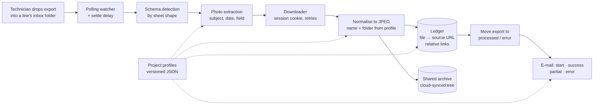

# Inspection Photo Archiver

A 24/7 desktop service that watches cloud-synced folders for inspection exports, downloads the photo
evidence from a third-party inspection app, files it under a per-project folder scheme and keeps a
cumulative, clickable ledger from every archived file back to its source. Built at **Intervalor Data**
(2026) for the operations team of a public-sector client.

> This repository is a **case study plus a clean-room reimplementation** of selected patterns.
> It contains no client code, data, names or infrastructure details. All sample data is synthetic.

---

## Context

- Field technicians run compliance inspections across hundreds of commercial sites, grouped into a
  dozen business lines, and capture photos in a third-party inspection app.
- The client's deliverables need that evidence **archived in a shared folder tree**, named and
  organised so a person can find "the photo of site X on day Y" in seconds.
- It started as two hard-coded scripts, one per contract, each with its own loop and settings.
  Adding a project meant copying a script.
- The archive lives in a cloud-synced folder shared with the client team, so files arrive
  incrementally, can be open in a spreadsheet app, or exist only as placeholders not yet downloaded.

## My role

Sole designer and developer: architecture, implementation, production support and the incident
write-ups. I turned the operations team's filing rules into configuration, and wrote the guide that
let a colleague add new business lines **without touching code**. ~100 commits, 19 decision records.

## Architecture



One desktop app (one tab and one watcher per project) reads **two layers of configuration**: project
instances (which folders, which profile, detection delay) and processing profiles (naming, folder
levels, ledger mode, notifications). Adding a project is a profile plus a row; the tabs, paths and
auto-start follow from configuration.

## Key decisions

| Decision | Rejected alternative | Why |
|---|---|---|
| One app, one watcher per project, behaviour in JSON profiles | One script per project | Adding a project became configuration; went from 2 to 14 watchers |
| Polling observer with a settle delay and temp-file filter | Native file-system events | The sync client writes files in stages; native events fired on half-written files |
| Ledger load can migrate, back up or **abort** — never reset | Recreate it empty on a read error | That "safe" reset silently erased months of history ([lesson 01](docs/lessons/01-ledger-that-emptied-itself.md)) |
| Unreadable ledger **aborts the whole run** | Download anyway, skip the ledger | Skipped rows are never registered later; aborting is self-correcting |
| Links stored **relative to the ledger** | Absolute link per cell | Absolute links broke on three folder reorganisations ([lesson 03](docs/lessons/03-absolute-links-broke-three-times.md)) |
| Photo's subject: the inspection's site wins, the row's element is the fallback | A list of forms that behave differently | One data rule covers both shapes and the next one ([lesson 06](docs/lessons/06-whose-photo-is-it.md)) |
| Warn when an export sits in the wrong business line's inbox; don't re-route | Automatic re-routing | It would move only a few percent of photos and change where technicians expect their files; a warning is reversible |
| Abort an export where a migrating form carries the same photos twice | Warn and download | De-duplication is by URL and re-uploaded images get new URLs; duplicates in a cumulative ledger are expensive to undo |
| Each folder level declares which field it reads from | A new level type per case | One generic lever instead of a code change for every new grouping |

## Results

| Area | Before | After |
|---|---|---|
| Projects served | 2 hard-coded scripts | **14 watchers** from configuration; 8 lines added by a colleague with no code change |
| Ledger history | Months silently erased by a read error | **~21k records rebuilt**; an open, unsynced or old-format file can no longer erase it |
| Exports stuck in the inbox (and re-downloaded) | 2 of 4 real inputs failed to move | **0**, locked by a test that moves the file with the GC disabled |
| Links after a folder reorganisation | Broke 3 times (up to ~8k links at once) | Relative links survive a tree move; repairs verified by resolving every link to a file on disk (e.g. ~8k of ~8k) |
| Photos filed when the write-up is late | "0 errors" with photos missing | Filed in the right month; the error folder only holds genuine cases |
| Folder-scheme change | — | Simulated on a real export without downloading, then matched production **photo for photo** |
| Regression caught before deploy | — | One site's photos would have spread over ~40 folders instead of 2 |
| Path length in production | — | Measured worst case, a couple of characters under the 260-char limit, with a documented mitigation |

## Engineering practices

- **Tests that prove they detect.** Each regression test was checked by reintroducing the bug and
  watching it fail. Tests run against real inputs where the bug only shows up on real data.
- **Invariants, not snapshots.** Rules checked over *every* profile at rest (own e-mail prefix,
  ledger present, known folder levels…) and "every code we can emit exists as a folder", instead of
  freezing today's values into a test that fails the day someone fixes the data.
- **Deploy verification that runs the code.** A post-unzip check exercises the critical rules on the
  target machine and reports where each module is imported from. A version string proves nothing.
- **Tests that don't touch the world.** Error-path tests once sent real alert e-mails; notifications
  are now stubbed out before any test reaches the pipeline.
- **Fail loudly, degrade softly.** Destructive or ambiguous situations abort and alert; optional
  reference data missing only logs a warning and processing continues.
- **Secrets.** The API session token resolves from environment → local file → fallback, so it can be
  rotated without a code change or a restart.
- **Docs as code.** 19 decision records, a changelog with measured before/after for every fix, and
  repair tools that dry-run by default, back up first and are idempotent.

## Lessons

- [The ledger that emptied itself](docs/lessons/01-ledger-that-emptied-itself.md)
- [The garbage collector was hiding a file lock](docs/lessons/02-garbage-collector-hid-a-file-lock.md)
- [Absolute links broke three times](docs/lessons/03-absolute-links-broke-three-times.md)
- [One object, five projects: the e-mail with the wrong subject](docs/lessons/04-one-object-five-projects.md)
- ["Thousands downloaded, 0 errors" — and photos missing](docs/lessons/05-zero-errors-missing-photos.md)
- [Whose photo is it? A rule that two tests must hold at once](docs/lessons/06-whose-photo-is-it.md)
- [The deploy wipes the install — design for it](docs/lessons/07-deploy-wipes-the-install.md)

## Demo

Three clean-room reimplementations, standard library only, with synthetic data in temp folders.

- [`src/safe_ledger.py`](src/safe_ledger.py) — a cumulative ledger whose load can only be `new`,
  `loaded`, `migrated` or `reset` **after a backup**; an unreadable file is retried and then raises.
  Writes are atomic.
- [`src/destination_resolver.py`](src/destination_resolver.py) — one-scan index of every month a site
  has a folder in, and the "same month → earliest later month → errors" rule.
- [`src/relative_links.py`](src/relative_links.py) — links relative to the ledger, verification by
  resolving each link to a file, and a repair that re-points moved files, refuses to guess between
  two candidates and aborts if too many links fail at once.

```bash
python -m unittest discover -s tests -v        # 21 tests, Python >= 3.10, no dependencies
```

Mutation-checked: making the ledger reset on a read error, looking only in the photo's own month,
storing absolute links or removing the repair threshold each makes the suite fail.

## Stack

Python (pandas, openpyxl, watchdog, requests, Pillow) · Tkinter · SMTP notifications ·
cloud-synced file shares · PowerShell packaging and deployment scripts · Markdown decision records.

> Disclaimer: clean-room reimplementation; no client code or data.
